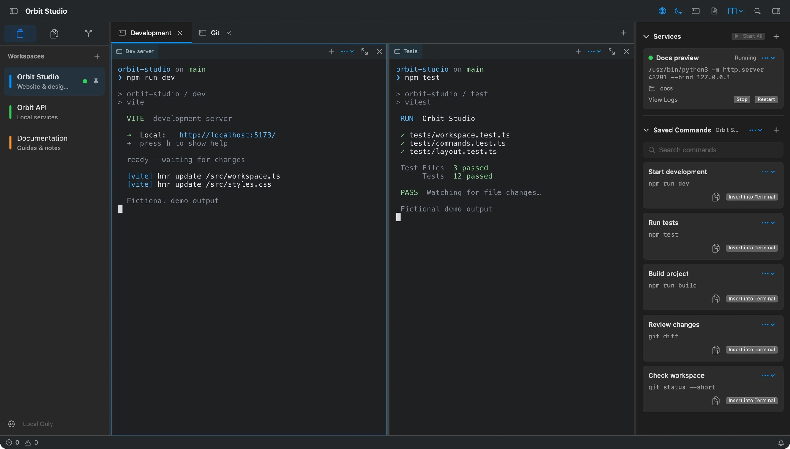
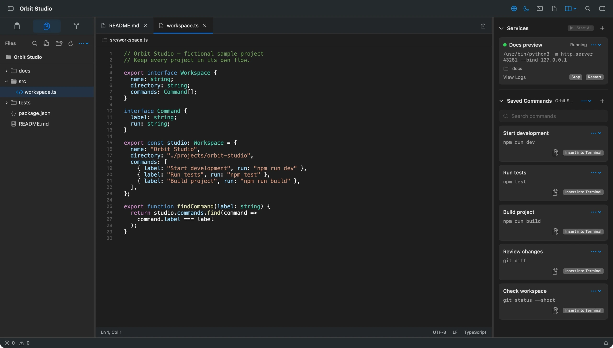

# vsux

**Languages: [English](README.md) | [简体中文](README.zh-CN.md)**

A native macOS terminal workspace for developers. Manage projects, terminal splits, files, and Git in one window. The interface is built with SwiftUI and AppKit; Ghostty provides terminal rendering and PTY support.

[](https://github.com/shadowDragons/vsux/releases)
[](LICENSE)


[Website](https://web-delta-seven-29.vercel.app/) · [Download the macOS DMG](https://github.com/shadowDragons/vsux/releases/download/v0.1.2/vsux-0.1.2-macos-arm64.dmg) · [All releases](https://github.com/shadowDragons/vsux/releases) · [Report an issue](https://github.com/shadowDragons/vsux/issues)

> v0.1.2 is an Apple Silicon preview for macOS 14 or later. The app is ad-hoc signed and not notarized by Apple. Read [Installation](#installation) and [Security boundaries](#security-boundaries) before downloading.

## Contents

- [Features](#features)
- [Screenshots](#screenshots)
- [Installation](#installation)
- [Getting started](#getting-started)
- [Build from source](#build-from-source)
- [Data and privacy](#data-and-privacy)
- [Security boundaries](#security-boundaries)
- [Scope](#scope)
- [Contributing](#contributing)
- [License and acknowledgements](#license-and-acknowledgements)

## Features

- **Project workspaces:** Switch between local directories. Name, reorder, pin, or move workspaces to separate windows.
- **Terminals and splits:** Keep multiple terminal tabs in each workspace and split panes in four directions. Layouts, working directories, and appearance settings are saved locally.
- **Commands and services:** Save commands per workspace, run development services in the background, and inspect recent output.
- **Quick Tunnel:** Share a local HTTP port through a temporary Cloudflare URL. Requires a separately installed `cloudflared`; starting a tunnel asks for confirmation because anyone with the link can access the service.
- **File tools:** Browse, search, edit, and replace text within a workspace. Includes line numbers, syntax highlighting, and live Markdown preview.
- **Git:** Inspect repository status and diffs, stage and commit changes, switch branches, and use common remote, stash, tag, and worktree operations.
- **Native macOS experience:** Uses the system input methods, clipboard, mouse selection, and default shell. The interface is available in English and Simplified Chinese.

The app has no cloud account, sync, embedded browser, or AI agent. Git commands and configured background refreshes may contact the remotes set for your repositories.

## Screenshots

**Workspaces, split terminals, background services, and saved commands**



**File tree, syntax highlighting, and editing alongside project services**



## Installation

1. Download `vsux-0.1.2-macos-arm64.dmg` from the [v0.1.2 release](https://github.com/shadowDragons/vsux/releases/tag/v0.1.2).
2. Open the disk image and drag `vsux.app` to `Applications`.
3. Optionally download the `.dmg.sha256` file from the same release and verify the image:

   ```sh
   shasum -a 256 -c vsux-0.1.2-macos-arm64.dmg.sha256
   ```

This preview does not have an Apple Developer ID signature or notarization. If macOS blocks the app, first verify the download source and checksum, then follow the prompt in System Settings under Privacy & Security. Do not disable Gatekeeper globally.

## Getting started

1. Click the `+` in the left sidebar and choose a local project directory to create a workspace.
2. Click the middle `+` to add a terminal. Use the terminal toolbar's split menu to divide a pane.
3. Select the file or Git icon to open those tools. Press `⌘S` to save file edits.
4. Add frequently used commands in the right sidebar. **Fill Terminal** inserts a command into the terminal; review it and press Return yourself to run it.

Common shortcuts:

| Action | Shortcut |
| --- | --- |
| New window | `⌘N` |
| New terminal tab | `⌘T` |
| Split right | `⌘D` |
| Split down | `⌘⇧D` |
| Find in workspace files | `⌘⇧F` |
| Markdown side preview | `⇧⌘V` |

## Build from source

Requires macOS 14 or later, Apple Silicon, and Xcode 26 / Swift 6.2 or a newer toolchain. The first build downloads a pinned GhosttyKit build (about 123 MB) and SwiftPM dependencies. GhosttyKit is verified against a SHA-256 checksum before use.

```sh
git clone https://github.com/shadowDragons/vsux.git
cd vsux
./Scripts/build.sh
open dist/vsux.app
```

Run the tests and localization checks:

```sh
swift test
python3 Scripts/check-localizations.py
```

Local builds of `dist/vsux.app` are ad-hoc signed. To build a DMG and checksum, run `Scripts/release.sh 0.1.2`; the outputs are written to `dist/`. See the [release guide](docs/RELEASING.md) for the full process.

## Data and privacy

Workspaces, terminal layouts, editor tabs, and settings are stored locally. The app does not provide accounts or cloud sync. Git network access uses each repository's configured remotes and the local Git credential helper.

Workspace and command data are stored as local JSON in `~/Library/Application Support/vsux/`. The app's bundle identifier is `local.vsux.app`. These files have local filesystem permissions but are not encrypted. Relaunching restores workspace layouts and starts new shells; running processes, scrollback, and unsaved edits are not restored.

## Security boundaries

vsux runs shells, Git, and workspace services with the permissions of your macOS user. It is not a sandbox for untrusted projects. Shell startup files, Git hooks, credential helpers, and remote helpers may execute code; open only workspaces you trust. Exported command libraries may also contain sensitive text you entered, so review them before sharing.

Markdown preview renders raw HTML as text and blocks remote resources and local resources outside the workspace. See [SECURITY.md](SECURITY.md) for more details and vulnerability reporting instructions.

## Scope

The editor provides text editing and syntax highlighting, but not language servers, intelligent completion, or code navigation. Git covers common workflows; interactive rebase, cherry-pick, a dedicated merge-conflict editor, and submodule management are not currently included. Markdown preview does not currently support Mermaid or math. The project has no plugin SDK or embedded AI integration.

## Contributing

Use [GitHub Issues](https://github.com/shadowDragons/vsux/issues) to report bugs or discuss improvements. Pull requests are welcome. Before submitting, run:

```sh
Scripts/bootstrap-ghostty.sh
swift test
python3 Scripts/check-localizations.py
```

For website changes, also run `npm ci`, `npm audit`, and `npm run build` from `web/`. Do not commit personal paths, credentials, signing keys, or real workspace data. Report security issues privately using the process in [SECURITY.md](SECURITY.md).

## License and acknowledgements

Original vsux code is licensed under the [MIT License](LICENSE). Third-party dependencies and their respective notices are listed in [THIRD_PARTY_NOTICES.md](THIRD_PARTY_NOTICES.md). Terminal rendering and PTY support are provided by [Ghostty](https://github.com/ghostty-org/ghostty).

Project link: [github.com/shadowDragons/vsux](https://github.com/shadowDragons/vsux)
