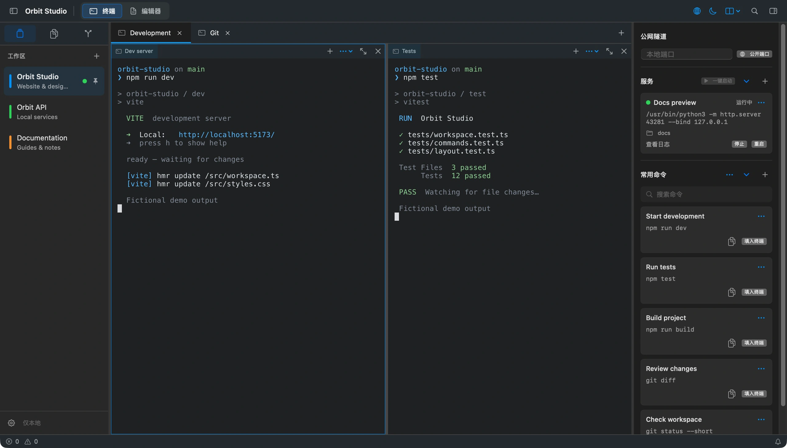
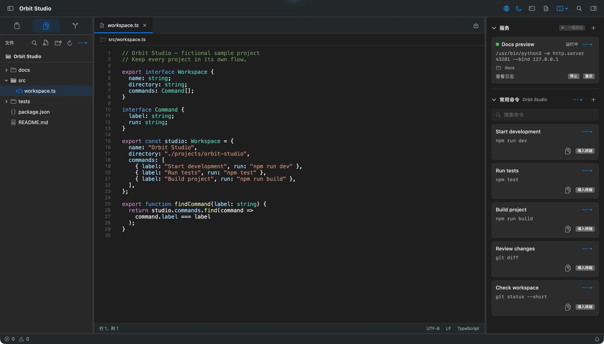
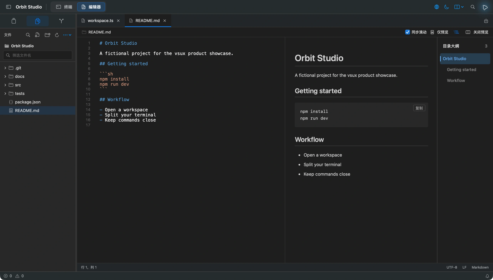
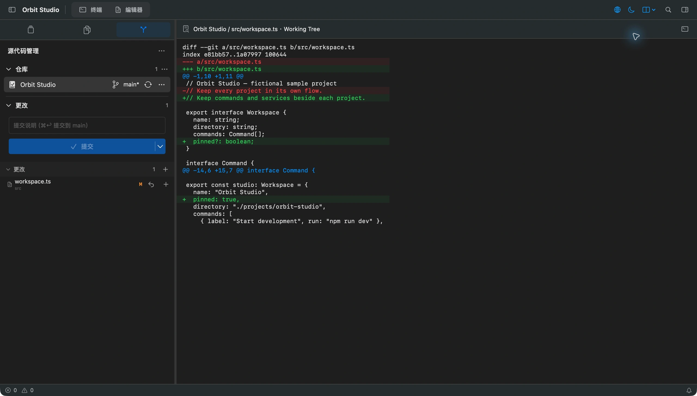

# vsux

**语言：简体中文 | [English](README.md)**

一款免费开源的 macOS 轻量编辑器。以终端为核心，在一个窗口里同时推进多个项目。继续使用你习惯的 AI 编程工具，把终端分屏、文件、Git、常用命令和后台服务按项目放在一起。

使用 SwiftUI / AppKit 构建原生界面，终端渲染与 PTY 由 Ghostty 提供。代码采用 MIT 协议。**仅支持 macOS 14+ 和 Apple Silicon。**

[](https://github.com/shadowDragons/vsux/releases)
[](LICENSE)


[官网](https://web-delta-seven-29.vercel.app/) · [下载 macOS DMG](https://github.com/shadowDragons/vsux/releases/download/v0.1.2/vsux-0.1.2-macos-arm64.dmg) · [查看所有 Release](https://github.com/shadowDragons/vsux/releases) · [报告问题](https://github.com/shadowDragons/vsux/issues)

> v0.1.2 是 Apple Silicon 预览版，支持 macOS 14 或更新版本。安装包采用临时签名，未经 Apple 公证；下载前请阅读[安装说明](#安装)和[安全边界](#安全边界)。

如果它适合你的工作习惯，欢迎[点个 Star](https://github.com/shadowDragons/vsux)。你也可以基于源码，让 AI 帮你添加需要的功能、删掉用不到的功能，再构建自己的版本。遇到问题、有功能需求或改进建议，都欢迎到 [Issues](https://github.com/shadowDragons/vsux/issues) 提出来。

## 为什么做 vsux

我越来越经常同时推进几个项目：一个让 AI 改页面，一个跑测试，还有一个服务开着，等我检查效果。我想把仍然需要自己接手的终端、文件、差异检查、命令和服务，放到同一个工作区里。

vsux 没有内置 AI Agent，继续在终端里使用你习惯的编程工具即可。编辑器提供文本编辑和语法着色；需要补全、代码导航或调试时，可以按实际需求选择完整 IDE。

查看[图文介绍](https://web-delta-seven-29.vercel.app/?view=story)。

## 目录

- [功能](#功能)
- [截图](#截图)
- [安装](#安装)
- [快速上手](#快速上手)
- [从源码构建](#从源码构建)
- [数据与隐私](#数据与隐私)
- [安全边界](#安全边界)
- [当前范围](#当前范围)
- [参与贡献](#参与贡献)
- [许可证与鸣谢](#许可证与鸣谢)

## 功能

- **项目工作区**：在多个本地目录间切换；工作区可命名、排序、置顶或拆到独立窗口。
- **终端与分屏**：每个工作区拥有多个终端标签和四向分屏；布局、当前目录与外观设置会在本机保存。
- **项目命令与服务**：保存工作区专属的常用命令；将开发服务器等命令放到后台运行，并查看最近输出。
- **公网隧道**：通过 Cloudflare 临时地址分享本地 HTTP 端口；需另行安装 `cloudflared`。启动前会确认公开访问，任何拿到链接的人都可能访问该服务。
- **文件工具**：在工作区内浏览、搜索、编辑和替换文本；支持行号、语法着色以及 Markdown 实时预览。
- **Git**：查看本地仓库状态与 Diff，暂存、提交、切换分支，并使用常见远程、Stash、标签和 Worktree 操作。
- **原生体验**：支持 macOS 输入法、系统剪贴板、鼠标选择和默认 Shell；界面提供简体中文与 English。

应用不包含云账号、云同步、嵌入式浏览器或 AI Agent。Git 远程命令和配置的后台刷新可能访问仓库所设置的远程地址。

## 截图

**多项目工作区、终端分屏、后台服务与常用命令**



**文件树、语法高亮与代码编辑，右侧管理项目服务**



**Markdown 源码、实时预览与目录大纲**



**先检查文件差异，再暂存和提交**



截图于 2026 年 11 月 12 日，来自当前原生应用。Orbit Studio 为虚构演示项目，终端输出为示例内容，不是性能测试结果。

## 安装

1. 从 [v0.1.2 Release](https://github.com/shadowDragons/vsux/releases/tag/v0.1.2) 下载 `vsux-0.1.2-macos-arm64.dmg`。
2. 打开磁盘映像，将 `vsux.app` 拖到 `Applications`。
3. 可选：下载同一页面上的 `.dmg.sha256`，在终端验证文件完整性：

   ```sh
   shasum -a 256 -c vsux-0.1.2-macos-arm64.dmg.sha256
   ```

当前预览版没有 Apple Developer ID 签名或公证。如果 macOS 阻止打开，请先确认下载来源与校验和，再按系统“隐私与安全性”中的提示操作。不要全局关闭 Gatekeeper。

## 快速上手

1. 点击左侧 `+`，选择一个本地项目目录以创建工作区。
2. 点击中间 `+` 新建终端；使用终端工具栏的分屏菜单拆分面板。
3. 点击文件或 Git 图标切换到对应工具；编辑文件后按 `⌘S` 保存。
4. 在右侧命令栏添加常用命令。选择“填入终端”只会把命令放入终端，需由你检查并按回车执行。

常用快捷键：

| 操作 | 快捷键 |
| --- | --- |
| 新建窗口 | `⌘N` |
| 新建终端标签 | `⌘T` |
| 右侧分屏 | `⌘D` |
| 下方分屏 | `⌘⇧D` |
| 查找工作区文件 | `⌘⇧F` |
| Markdown 侧边预览 | `⇧⌘V` |

## 从源码构建

需要 macOS 14 或更新版本、Apple Silicon，以及 Xcode 26 / Swift 6.2 或更新工具链。首次构建需要联网下载固定版本的 GhosttyKit（约 123 MB）和 SwiftPM 依赖；GhosttyKit 会先校验 SHA-256。

```sh
git clone https://github.com/shadowDragons/vsux.git
cd vsux
./Scripts/build.sh
open dist/vsux.app
```

运行测试与本地化检查：

```sh
swift test
python3 Scripts/check-localizations.py
```

本机生成的 `dist/vsux.app` 使用临时签名。构建正式 DMG 可运行 `Scripts/release.sh 0.1.2`；产物和校验文件写入 `dist/`。完整发布流程见[发布说明](docs/RELEASING.md)。

## 数据与隐私

工作区、终端布局、编辑器标签和设置保存在本机。应用不提供账号或云同步功能；Git 网络访问使用仓库配置的远程与本机 Git 凭据助手。

工作区和命令数据以本地 JSON 形式保存在 `~/Library/Application Support/vsux/`，应用标识为 `local.vsux.app`。相关文件设置了本机文件权限，但没有加密。关闭并重启应用会恢复工作区布局并启动新的 Shell；正在运行的进程、滚屏内容和未保存编辑不会恢复。

## 安全边界

vsux 会以当前 macOS 用户权限运行 Shell、Git 和工作区服务，不是执行不可信项目的沙箱。Shell 启动文件、Git hooks、凭据助手和远程助手可能运行代码；只打开你信任的工作区。导出的常用命令文件也可能含有你写入的敏感内容，分享前请检查。

Markdown 预览会将原始 HTML 显示为文本，阻止远程资源和工作区目录之外的本地资源。更多信任边界及漏洞报告方式见 [SECURITY.md](SECURITY.md)。

## 当前范围

编辑器提供文本编辑和语法着色，不提供语言服务器、智能补全或代码导航。Git 工具覆盖常见工作流，目前没有交互式变基、cherry-pick、专用冲突合并编辑器或子模块管理。Markdown 预览暂不支持 Mermaid 与数学公式。项目没有插件 SDK 或嵌入式 AI 集成。

## 参与贡献

欢迎通过 [Issues](https://github.com/shadowDragons/vsux/issues) 报告问题、提出功能需求或讨论改进，也欢迎提交 Pull Request。你可以 Fork 采用 MIT 协议的源码，让自己的 AI 编程工具协助修改；使用或分享构建产物前，请检查改动并运行验证。提交前请运行：

```sh
Scripts/bootstrap-ghostty.sh
swift test
python3 Scripts/check-localizations.py
```

涉及网站时，再从 `web/` 运行 `npm ci`、`npm audit` 和 `npm run build`。请勿提交个人路径、凭据、签名密钥或真实工作区数据；安全问题请按 [SECURITY.md](SECURITY.md) 中的方式私下报告。

## 许可证与鸣谢

vsux 原创代码采用 [MIT License](LICENSE)。项目依赖及各自的版权和许可见 [THIRD_PARTY_NOTICES.md](THIRD_PARTY_NOTICES.md)；其中包括由 [Ghostty](https://github.com/ghostty-org/ghostty) 提供的终端渲染与 PTY 能力。

项目链接：[github.com/shadowDragons/vsux](https://github.com/shadowDragons/vsux)
